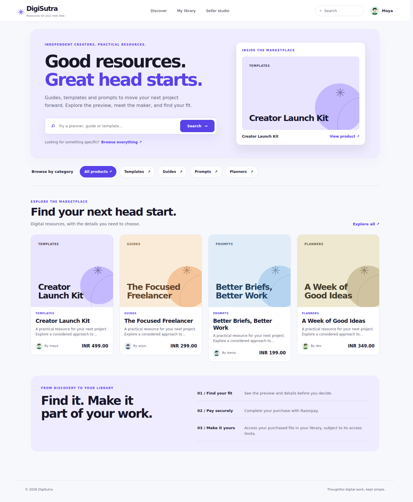
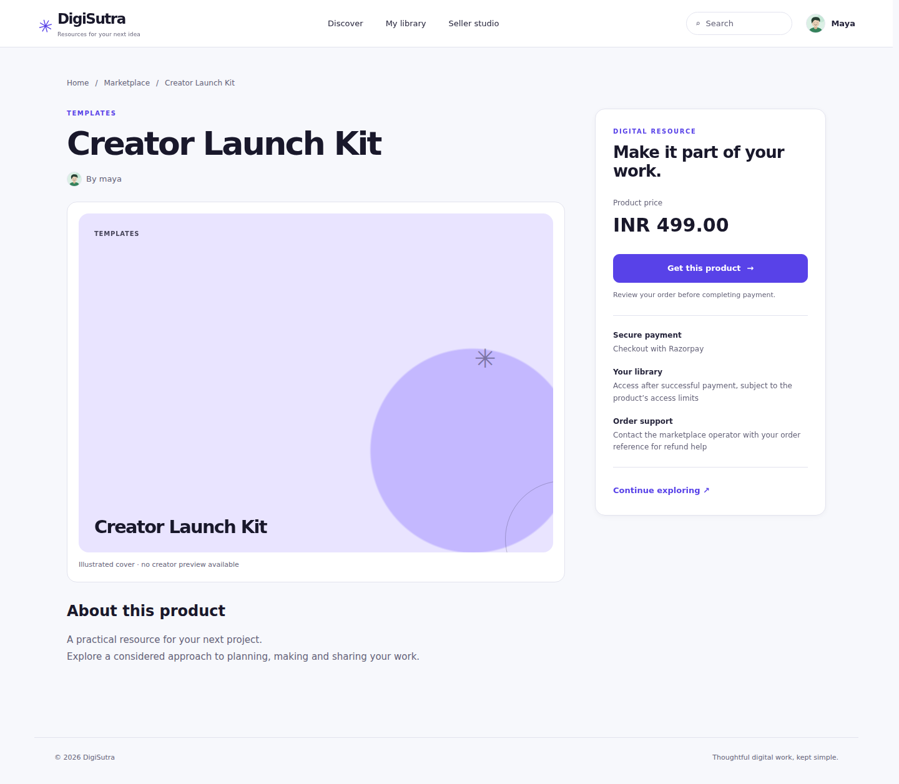
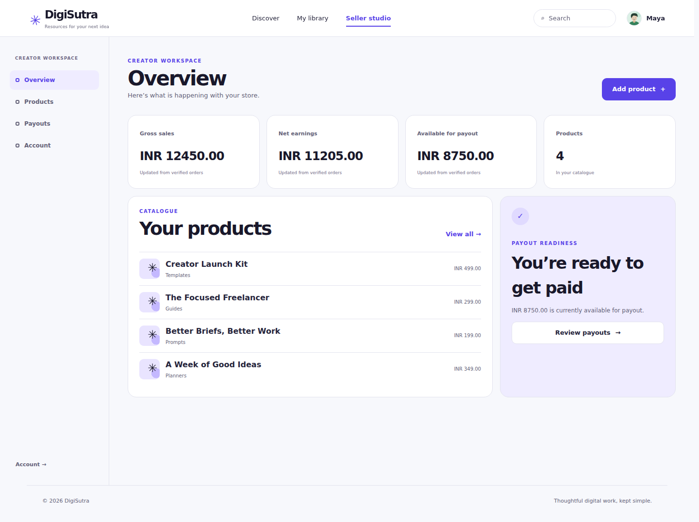
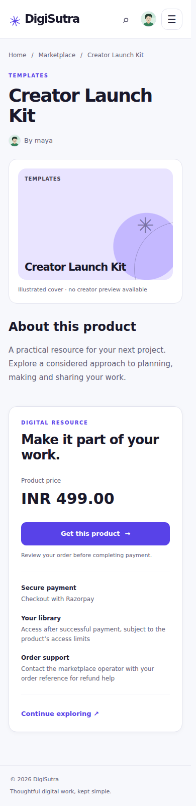

# Indigo + Cloud redesign

DigiSutra now uses indigo actions (#5842e8), cloud page backgrounds (#f7f8fc), white panels and dark ink. This implements the approved visual direction in the existing JavaScript client and builds on the merged avatar PR #22.

| Surface | Result |
|---|---|
| Home | Search beside a real public listing; category entry points; resource cards with creator identity and price |
| Catalog | Clear search/filter controls and quieter collection header |
| Product | Breadcrumbs, creator identity, preview, full description and a separate purchase summary |
| Seller/account/library | Shared indigo controls, navigation, fields, status surfaces and readable figures |

The spotlight uses the first returned listing; it makes no popularity or editorial-curation claim. A creator’s image is retained when present, with the shared illustrated fallback otherwise. Overlaid card badges were removed so they cannot obscure previews. Empty/loading states do not invent purchasable products. On narrow screens the purchase panel returns to document flow.

`apps/web/indigo-cloud.css` replaces `calm-toolkit.css` as the canonical theme loaded by `index.html`. DESIGN.md mirrors its values and UX-CONTRACT.md records the layout behavior. No dependencies, API contracts, permission logic, payment calculations or download entitlements change.

## Reconcile drift

| Previous rule | Approved change | Runtime resolution |
|---|---|---|
| Green brand and gold focus | Indigo + Cloud | Shared theme tokens, focus and selected navigation |
| Decorative stacked folio hero | Resource-first discovery | Real listing spotlight and existing search action |
| Product details mixed with buying copy | Separate reading and purchase areas | Shared detail markup and responsive purchase panel |

## Validation

- `npm test --prefix apps/web`: 32/32 pass, including spotlight identity/escaping, empty/loading truthfulness, full product description and a single purchase action.
- `python -m unittest discover -s apps/web/tests -p '*_test.py'`: 1/1 pass; deep links load the renamed stylesheet.
- `git diff --check`: pass.
- `npx --yes -p @google/design.md designmd lint DESIGN.md`: 0 errors, 7 existing orphan-token warnings.
- Strict premium static audit: same 16 pre-existing actionless-button findings before and after; no new findings. This is not a clean repository-wide audit.
- Real Chromium with fixture API responses: home, catalog, product, seller overview/products/new, settings, library and auth at 1440, 768, 390 and 320px. No page errors or horizontal document overflow in 36 checks.
- Browser interactions: submitted search, clear and focus return, native category select, mobile navigation, empty catalog, delayed loading, error/retry and reduced motion passed.
- axe-core WCAG A/AA checks: zero violations on home, catalog, product detail and seller overview at desktop width. This is automated sampling, not a complete accessibility certification.
- No frontend build, lint or typecheck scripts are configured. Live Razorpay, production API and protected download delivery were not exercised; existing orchestration tests remain in place.

## Screenshots

Screenshots use representative fixture listings and seller totals; these are review data, not production claims.

